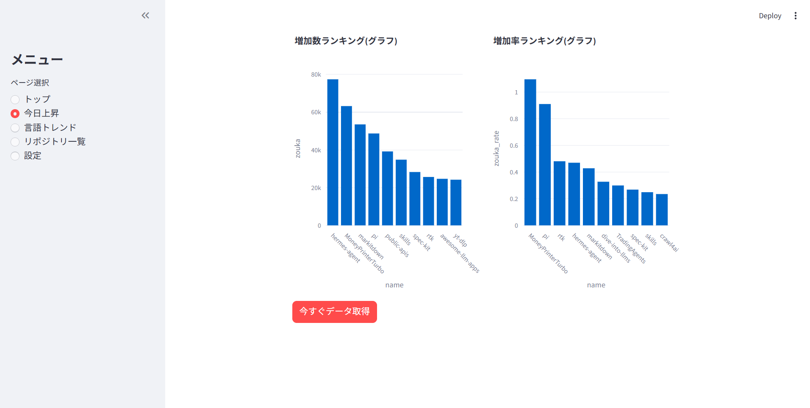

# GitHub Trend Curator

登録したキーワード（言語・技術）をもとにGitHubのリポジトリを毎日取得・蓄積し、言語別トレンドや日別ランキングを可視化するデータダッシュボードです。

## 概要

データエンジニアリングの基礎を実践的に学ぶために開発しました。GitHub APIからデータを取得してDuckDBに保存し、dbtで整形・集計してStreamlitで可視化するELTパイプラインを構築しています。

単に「動くもの」を作るだけでなく、以下の点を重視して開発しています。

- スター数の**絶対値**だけでなく、前回取得時からの**増加数・増加率**を独自に算出し、「今、伸びているリポジトリ」を見つけられるようにする
- dbtのカスタムテスト・組み込みテストによる**データ品質の担保**
- 依存関係（`ref()`）を明示したモデル設計による、**保守しやすいdbtプロジェクト構成**

## スクリーンショット

### 今日上昇（増加数・増加率ランキング）

前回取得時点からの伸びを「増加数」「増加率」の2軸で可視化しています。絶対値ランキングだけでは埋もれてしまう、規模の割に急成長しているリポジトリを見つけることを狙いとしています。



## アーキテクチャ

```
GitHub API
  ↓ Extract（httpx）
DuckDB（Raw層: raw_repositories）
  ↓ Transform（dbt）
DuckDB（staging層 / marts層）
  ↓
Streamlit ダッシュボード
```

## 機能

- キーワード（言語・技術）の登録・削除
- 登録キーワードに一致するリポジトリの取得・蓄積
- 言語別スター数のトレンド可視化
- 日別Top10リポジトリの表示（スター数の絶対値順）
- **日別Top10リポジトリの表示（増加数順・増加率順）**
  - 前回取得データとの比較により、「今伸びているリポジトリ」を検出
  - 増加率ランキングは、小規模リポジトリでの誤差レベルの変動をノイズとして除外するため、比較対象のスター数に閾値を設定
- 1日1回のデータ取得制御（API制限対策）
- **dbtによるデータ品質テスト**
  - `not_null` / `unique` などの組み込みテスト
  - `dbt_utils.unique_combination_of_columns` による複合キーの一意性検証
  - 空文字混入やしきい値逸脱を検知するカスタムテスト

## 使用技術

| 技術 | 用途 |
|---|---|
| Python | メイン言語 |
| httpx | GitHub APIからデータ取得 |
| DuckDB | ローカル分析用データベース |
| dbt（dbt-duckdb） | データ整形・集計・テスト（ELTのT） |
| dbt-utils | 複合カラムの一意性テストなど |
| Streamlit | ダッシュボードUI |
| Plotly | インタラクティブグラフ |

## セットアップ

### 1. リポジトリをクローン

```bash
git clone https://github.com/Hryuta-dev/github-trend-curator.git
cd github-trend-curator
```

### 2. 仮想環境を作成・有効化

```bash
# Windows
python -m venv .venv
.venv\Scripts\Activate.ps1

# Mac/Linux
python -m venv .venv
source .venv/bin/activate
```

### 3. ライブラリをインストール

`requirements.txt` に記載のライブラリを一括インストールします。

```bash
pip install -r requirements.txt
```

### 4. GitHubトークンを設定

`.env` ファイルをプロジェクトルートに作成して以下を記入してください。

```
GITHUB_TOKEN=あなたのトークン
```

GitHubトークンは[こちら](https://github.com/settings/tokens)から発行できます。公開リポジトリの検索のみを行うため、`Public repositories (read-only)` スコープで十分です。

### 5. dbtの設定

`~/.dbt/profiles.yml` を作成して以下を記入してください。

```yaml
github_trends:
  target: dev
  outputs:
    dev:
      type: duckdb
      path: /あなたのパス/github_trends.duckdb
      schema: main
      threads: 1
```

### 6. dbtパッケージのインストール

```bash
cd transform/github_trends
dbt deps
cd ../..
```

### 7. データを取得してアプリを起動

```bash
# データ取得
python ingest/fetch.py

# dbtでデータ整形・テスト
cd transform/github_trends
dbt run
dbt test
cd ../..

# アプリ起動
streamlit run dashboard/app.py
```

ブラウザで `http://localhost:8501` を開いてください。

## ディレクトリ構成

```
github-trend-curator/
├── ingest/
│   └── fetch.py                            # GitHub APIからデータ取得・保存
├── transform/
│   └── github_trends/
│       ├── packages.yml                    # dbtパッケージ定義（dbt_utils）
│       ├── models/
│       │   ├── staging/
│       │   │   ├── stg_repositories.sql    # データ整形
│       │   │   └── stg_repositories.yml    # テスト・ドキュメント定義
│       │   └── marts/
│       │       ├── language_trends.sql             # 言語別集計
│       │       ├── daily_top10.sql                 # 日別Top10（絶対値順）
│       │       ├── daily_top10_by_growth.sql        # 日別Top10（増加数順）
│       │       ├── daily_top10_by_growth_rate.sql   # 日別Top10（増加率順）
│       │       └── marts.yml                        # テスト・ドキュメント定義
│       └── tests/
│           ├── assert_no_empty_language.sql               # 言語が空文字になっていないかの検証
│           └── assert_no_low_yesterday_stars_in_rate.sql  # 増加率算出時の閾値検証
├── dashboard/
│   └── app.py                # Streamlitダッシュボード（トップ／言語トレンド／リポジトリ一覧／今日上昇／設定）
├── keywords.json              # 追跡キーワード設定
├── requirements.txt           # 依存ライブラリ一覧
├── .env                       # GitHubトークン（要作成・Git管理外）
└── README.md
```

## データモデリングの設計方針

- `raw_repositories` は取得日ごとのスナップショットをそのまま蓄積する設計とし、`stg_repositories` 以降で品質を担保する（生データ層では緩いテスト、整形後は厳格なテスト、という方針）
- 増加数・増加率は、`stg_repositories` を `today` / `yesterday` の2つの視点で自己結合し、各リポジトリの直近の過去データとのペアを作った上で算出している
- 前回データが存在しないリポジトリ（新規検出）は `LEFT JOIN` により結果から除外せず、増加数・増加率は `NULL` として扱う

## 今後の改善予定

- [x] dbtのテスト追加
- [ ] 新規検出リポジトリ（前回データなし）を、増加数・増加率とは別の切り口で可視化する
- [ ] Airflow（Docker環境）による定期実行の自動化
- [ ] 冪等性・実行状態の可観測性の改善（スキップと成功の区別など）
- [ ] GitHub Actionsでのdbt test自動実行（CI）